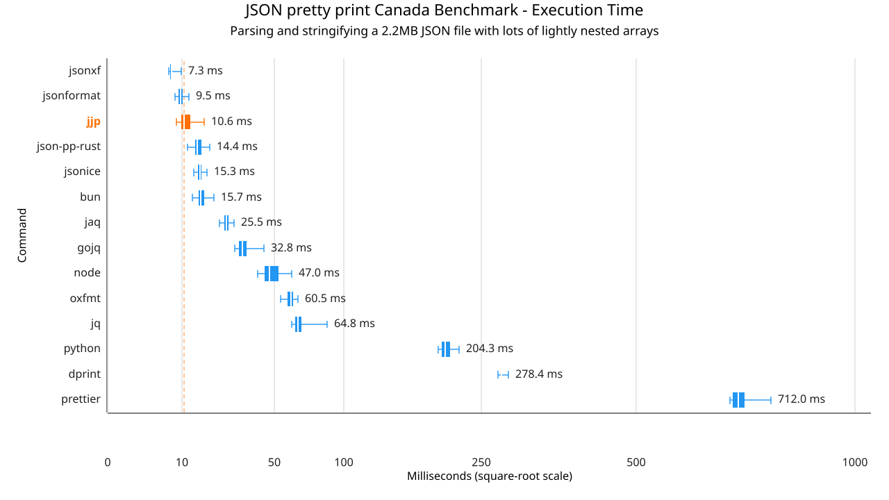
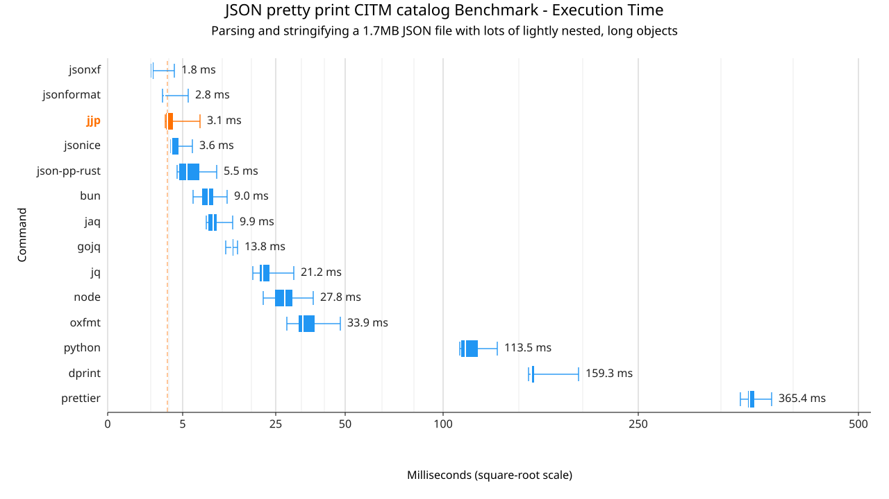
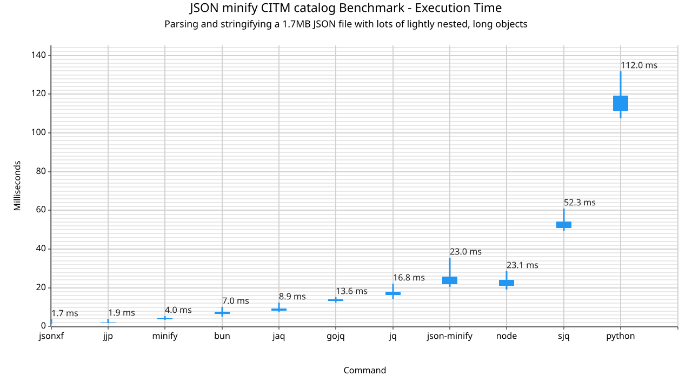
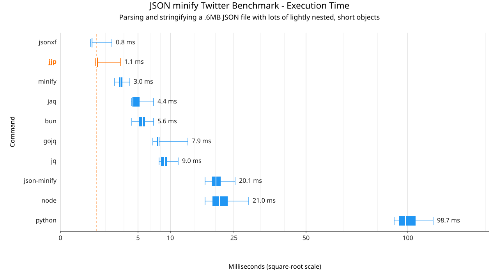

<!-- GENERATED FILE - update the templates in the xtask -->

# jjpwrgem CLI formatter and minifier benchmarks

Wall-clock timing against jq, prettier, dprint, and others via hyperfine. Run locally with `mise run bench-docker`
These benchmarks are run with `AMD Ryzen 5 5600X 6-Core Processor (3.70 GHz)`

The following JSON fixtures are used across benchmarks:

- [canada.json](/benches/data/canada.json) — 2.2MB, lots of lightly nested arrays, no strings

- [citm_catalog.json](/benches/data/citm_catalog.json) — 1.7MB, lots of lightly nested long objects, ASCII strings

- [twitter.json](/benches/data/twitter.json) — 0.6MB, lots of lightly nested short objects, multibyte strings

## canada

[canada.json](/benches/data/canada.json) — 2.2MB, lots of lightly nested arrays, no strings

### pretty canada

| Command        | Mean Wall Time [ms] |   Change | Factor         |
| :------------- | ------------------: | -------: | :------------- |
| `jjp`          |          11.1 ± 1.9 |          |                |
| `json-pp-rust` |          14.6 ± 1.5 |   +31.7% | (1.3x slower)  |
| `jsonice`      |          15.3 ± 0.8 |   +38.4% | (1.4x slower)  |
| `prettier`     |        721.7 ± 30.6 | +6409.7% | (65.1x slower) |
| `jq`           |          66.5 ± 5.4 |  +499.5% | (6.0x slower)  |
| `gojq`         |          33.3 ± 2.9 |  +200.3% | (3.0x slower)  |
| `jaq`          |          25.5 ± 1.3 |  +130.0% | (2.3x slower)  |
| `sjq`          |         192.7 ± 5.6 | +1637.8% | (17.4x slower) |
| `dprint`       |         279.2 ± 4.4 | +2418.7% | (25.2x slower) |
| `python`       |         206.3 ± 8.7 | +1760.6% | (18.6x slower) |
| `node`         |          48.1 ± 5.5 |  +333.4% | (4.3x slower)  |
| `bun`          |          15.9 ± 1.4 |   +43.3% | (1.4x slower)  |
| `jsonxf`       |           7.4 ± 0.5 |   -32.9% | (1.5x faster)  |
| `jsonformat`   |           9.6 ± 0.7 |   -13.2% |                |
| `oxfmt`        |          60.0 ± 2.5 |  +441.0% | (5.4x slower)  |

### ugly canada

| Command       | Mean Wall Time [ms] |   Change | Factor         |
| :------------ | ------------------: | -------: | :------------- |
| `jjp`         |           5.4 ± 0.7 |          |                |
| `json-minify` |          40.4 ± 2.7 |  +644.6% | (7.4x slower)  |
| `jsonxf`      |           8.0 ± 0.9 |   +47.0% | (1.5x slower)  |
| `jq`          |          44.4 ± 2.1 |  +719.1% | (8.2x slower)  |
| `jaq`         |          19.9 ± 0.9 |  +268.0% | (3.7x slower)  |
| `gojq`        |          30.9 ± 1.5 |  +471.0% | (5.7x slower)  |
| `sjq`         |         162.0 ± 7.0 | +2889.4% | (29.9x slower) |
| `python`      |         187.3 ± 9.5 | +3355.6% | (34.6x slower) |
| `minify`      |           9.6 ± 0.9 |   +76.6% | (1.8x slower)  |
| `node`        |          36.5 ± 2.5 |  +572.7% | (6.7x slower)  |
| `bun`         |          12.4 ± 1.7 |  +129.1% | (2.3x slower)  |

## citm catalog

[citm_catalog.json](/benches/data/citm_catalog.json) — 1.7MB, lots of lightly nested long objects, ASCII strings

### pretty citm catalog

| Command        | Mean Wall Time [ms] |    Change | Factor          |
| :------------- | ------------------: | --------: | :-------------- |
| `jjp`          |           3.5 ± 0.6 |           |                 |
| `json-pp-rust` |           6.0 ± 1.5 |    +72.0% | (1.7x slower)   |
| `jsonice`      |           4.0 ± 0.7 |    +15.8% |                 |
| `prettier`     |        368.9 ± 10.3 | +10529.8% | (106.3x slower) |
| `jq`           |          22.1 ± 2.5 |   +538.2% | (6.4x slower)   |
| `gojq`         |          13.8 ± 0.4 |   +296.3% | (4.0x slower)   |
| `jaq`          |           9.9 ± 1.0 |   +186.1% | (2.9x slower)   |
| `sjq`          |          60.2 ± 3.3 |  +1634.9% | (17.3x slower)  |
| `dprint`       |         162.3 ± 9.0 |  +4578.3% | (46.8x slower)  |
| `python`       |         116.8 ± 8.0 |  +3264.7% | (33.6x slower)  |
| `node`         |          28.0 ± 3.9 |   +705.5% | (8.1x slower)   |
| `bun`          |           9.0 ± 1.3 |   +160.4% | (2.6x slower)   |
| `jsonxf`       |           1.9 ± 0.4 |    -44.6% | (1.8x faster)   |
| `jsonformat`   |           3.1 ± 0.5 |    -10.5% |                 |
| `oxfmt`        |          35.3 ± 4.5 |   +917.6% | (10.2x slower)  |

### ugly citm catalog

| Command       | Mean Wall Time [ms] |   Change | Factor         |
| :------------ | ------------------: | -------: | :------------- |
| `jjp`         |           2.1 ± 0.4 |          |                |
| `json-minify` |          24.5 ± 3.6 | +1068.9% | (11.7x slower) |
| `jsonxf`      |           1.9 ± 0.3 |   -10.7% |                |
| `jq`          |          17.2 ± 1.6 |  +720.7% | (8.2x slower)  |
| `jaq`         |           9.0 ± 0.9 |  +326.8% | (4.3x slower)  |
| `gojq`        |          13.7 ± 0.6 |  +550.8% | (6.5x slower)  |
| `sjq`         |          52.8 ± 2.4 | +2415.5% | (25.2x slower) |
| `python`      |         114.9 ± 6.8 | +5377.2% | (54.8x slower) |
| `minify`      |           4.1 ± 0.4 |   +97.0% | (2.0x slower)  |
| `node`        |          22.9 ± 2.1 |  +990.9% | (10.9x slower) |
| `bun`         |           7.1 ± 0.8 |  +237.7% | (3.4x slower)  |

## twitter

[twitter.json](/benches/data/twitter.json) — 0.6MB, lots of lightly nested short objects, multibyte strings

### pretty twitter

| Command        | Mean Wall Time [ms] |    Change | Factor          |
| :------------- | ------------------: | --------: | :-------------- |
| `jjp`          |           1.7 ± 0.4 |           |                 |
| `json-pp-rust` |           2.6 ± 0.6 |    +50.5% | (1.5x slower)   |
| `jsonice`      |           2.5 ± 0.5 |    +45.9% | (1.5x slower)   |
| `prettier`     |         199.2 ± 5.7 | +11649.6% | (117.5x slower) |
| `jq`           |          11.2 ± 1.2 |   +561.9% | (6.6x slower)   |
| `gojq`         |           8.2 ± 0.4 |   +381.8% | (4.8x slower)   |
| `jaq`          |           5.2 ± 0.7 |   +205.2% | (3.1x slower)   |
| `sjq`          |          27.9 ± 1.3 |  +1544.1% | (16.4x slower)  |
| `dprint`       |          29.5 ± 2.7 |  +1642.0% | (17.4x slower)  |
| `python`       |         104.1 ± 8.4 |  +6041.9% | (61.4x slower)  |
| `node`         |          23.7 ± 3.2 |  +1298.6% | (14.0x slower)  |
| `bun`          |           5.6 ± 0.8 |   +227.4% | (3.3x slower)   |
| `jsonxf`       |           0.8 ± 0.2 |    -50.1% | (2.0x faster)   |
| `jsonformat`   |           1.9 ± 0.3 |    +14.7% |                 |
| `oxfmt`        |          31.9 ± 3.7 |  +1778.9% | (18.8x slower)  |

### ugly twitter

| Command       | Mean Wall Time [ms] |   Change | Factor         |
| :------------ | ------------------: | -------: | :------------- |
| `jjp`         |           1.2 ± 0.2 |          |                |
| `json-minify` |          23.2 ± 2.7 | +1833.3% | (19.3x slower) |
| `jsonxf`      |           0.8 ± 0.2 |   -29.8% |                |
| `jq`          |           9.6 ± 1.2 |  +704.4% | (8.0x slower)  |
| `jaq`         |           4.8 ± 0.7 |  +301.8% | (4.0x slower)  |
| `gojq`        |           8.1 ± 0.6 |  +577.8% | (6.8x slower)  |
| `sjq`         |          25.0 ± 1.0 | +1987.2% | (20.9x slower) |
| `python`      |          98.8 ± 7.0 | +8141.1% | (82.4x slower) |
| `minify`      |           3.1 ± 0.2 |  +154.4% | (2.5x slower)  |
| `node`        |          20.2 ± 2.1 | +1589.0% | (16.9x slower) |
| `bun`         |           5.4 ± 0.8 |  +350.0% | (4.5x slower)  |
