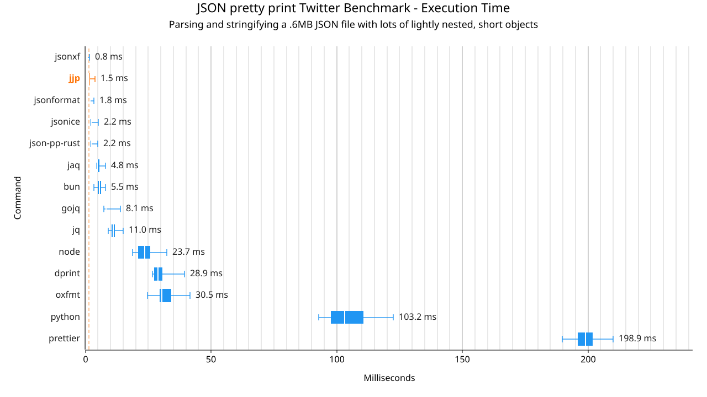

<!-- GENERATED FILE - update the templates in the xtask -->

# jjpwrgem CLI formatter and minifier benchmarks

Wall-clock timing against jq, prettier, dprint, and others via hyperfine. Run locally with `mise run bench-docker`
These benchmarks are run with `AMD Ryzen 5 5600X 6-Core Processor (3.70 GHz)`

The following JSON fixtures are used across benchmarks:

- [canada.json](/benches/data/canada.json) — 2.2MB, lots of lightly nested arrays, no strings

- [citm_catalog.json](/benches/data/citm_catalog.json) — 1.7MB, lots of lightly nested long objects, ASCII strings

- [twitter.json](/benches/data/twitter.json) — 0.6MB, lots of lightly nested short objects, multibyte strings

## canada

[canada.json](/benches/data/canada.json) — 2.2MB, lots of lightly nested arrays, no strings

### pretty canada

| Command        | Mean Wall Time [ms] |   Change | Factor         |
| :------------- | ------------------: | -------: | :------------- |
| `jjp`          |          11.0 ± 1.7 |          |                |
| `json-pp-rust` |          15.3 ± 1.3 |   +39.1% | (1.4x slower)  |
| `jsonice`      |          15.1 ± 0.9 |   +37.4% | (1.4x slower)  |
| `prettier`     |        775.4 ± 25.6 | +6933.8% | (70.3x slower) |
| `jq`           |          68.0 ± 2.4 |  +516.7% | (6.2x slower)  |
| `gojq`         |          32.5 ± 1.6 |  +194.9% | (2.9x slower)  |
| `jaq`          |          26.3 ± 1.4 |  +138.5% | (2.4x slower)  |
| `sjq`          |         202.5 ± 9.8 | +1736.6% | (18.4x slower) |
| `dprint`       |        297.2 ± 12.8 | +2596.3% | (27.0x slower) |
| `python`       |         209.8 ± 4.3 | +1803.0% | (19.0x slower) |
| `node`         |          45.5 ± 4.5 |  +312.9% | (4.1x slower)  |
| `bun`          |          15.8 ± 1.2 |   +42.9% | (1.4x slower)  |
| `jsonxf`       |           8.1 ± 1.0 |   -26.7% |                |
| `jsonformat`   |          10.2 ± 0.8 |    -7.7% |                |
| `oxfmt`        |          61.6 ± 2.9 |  +459.0% | (5.6x slower)  |

### ugly canada

| Command       | Mean Wall Time [ms] |   Change | Factor         |
| :------------ | ------------------: | -------: | :------------- |
| `jjp`         |           5.4 ± 0.5 |          |                |
| `json-minify` |          38.1 ± 2.0 |  +602.8% | (7.0x slower)  |
| `jsonxf`      |           7.9 ± 0.6 |   +46.0% | (1.5x slower)  |
| `jq`          |          46.7 ± 1.5 |  +761.8% | (8.6x slower)  |
| `jaq`         |          19.8 ± 1.0 |  +265.6% | (3.7x slower)  |
| `gojq`        |          31.1 ± 1.2 |  +474.0% | (5.7x slower)  |
| `sjq`         |         162.2 ± 8.9 | +2893.8% | (29.9x slower) |
| `python`      |         190.1 ± 6.0 | +3407.3% | (35.1x slower) |
| `minify`      |           9.4 ± 0.9 |   +72.8% | (1.7x slower)  |
| `node`        |          36.2 ± 2.2 |  +567.2% | (6.7x slower)  |
| `bun`         |          11.3 ± 1.1 |  +107.7% | (2.1x slower)  |

## citm catalog

[citm_catalog.json](/benches/data/citm_catalog.json) — 1.7MB, lots of lightly nested long objects, ASCII strings

### pretty citm catalog

| Command        | Mean Wall Time [ms] |    Change | Factor          |
| :------------- | ------------------: | --------: | :-------------- |
| `jjp`          |           3.4 ± 0.5 |           |                 |
| `json-pp-rust` |           5.8 ± 1.2 |    +70.6% | (1.7x slower)   |
| `jsonice`      |           4.0 ± 0.3 |    +16.2% |                 |
| `prettier`     |        383.2 ± 18.6 | +11095.8% | (112.0x slower) |
| `jq`           |          21.8 ± 1.3 |   +536.7% | (6.4x slower)   |
| `gojq`         |          13.4 ± 0.4 |   +290.7% | (3.9x slower)   |
| `jaq`          |          10.3 ± 1.0 |   +201.7% | (3.0x slower)   |
| `sjq`          |          61.6 ± 3.8 |  +1700.9% | (18.0x slower)  |
| `dprint`       |         164.2 ± 8.3 |  +4695.9% | (48.0x slower)  |
| `python`       |         122.1 ± 7.5 |  +3465.5% | (35.7x slower)  |
| `node`         |          26.4 ± 3.5 |   +672.2% | (7.7x slower)   |
| `bun`          |           7.7 ± 0.9 |   +123.6% | (2.2x slower)   |
| `jsonxf`       |           1.8 ± 0.2 |    -46.1% | (1.9x faster)   |
| `jsonformat`   |           3.1 ± 0.4 |    -10.3% |                 |
| `oxfmt`        |          32.5 ± 2.2 |   +850.3% | (9.5x slower)   |

### ugly citm catalog

| Command       | Mean Wall Time [ms] |   Change | Factor         |
| :------------ | ------------------: | -------: | :------------- |
| `jjp`         |           2.1 ± 0.4 |          |                |
| `json-minify` |          22.6 ± 2.2 |  +964.4% | (10.6x slower) |
| `jsonxf`      |           1.8 ± 0.3 |   -14.0% |                |
| `jq`          |          17.3 ± 1.2 |  +716.8% | (8.2x slower)  |
| `jaq`         |           8.5 ± 1.0 |  +301.6% | (4.0x slower)  |
| `gojq`        |          13.1 ± 0.4 |  +516.1% | (6.2x slower)  |
| `sjq`         |          55.2 ± 2.2 | +2502.9% | (26.0x slower) |
| `python`      |         120.1 ± 6.4 | +5561.7% | (56.6x slower) |
| `minify`      |           4.0 ± 0.5 |   +87.7% | (1.9x slower)  |
| `node`        |          22.5 ± 2.0 |  +960.9% | (10.6x slower) |
| `bun`         |           5.8 ± 0.8 |  +173.0% | (2.7x slower)  |

## twitter

[twitter.json](/benches/data/twitter.json) — 0.6MB, lots of lightly nested short objects, multibyte strings

### pretty twitter

| Command        | Mean Wall Time [ms] |    Change | Factor          |
| :------------- | ------------------: | --------: | :-------------- |
| `jjp`          |           1.7 ± 0.4 |           |                 |
| `json-pp-rust` |           2.7 ± 0.7 |    +63.5% | (1.6x slower)   |
| `jsonice`      |           2.4 ± 0.4 |    +42.6% | (1.4x slower)   |
| `prettier`     |         203.7 ± 7.5 | +12054.3% | (121.5x slower) |
| `jq`           |          10.4 ± 0.9 |   +523.6% | (6.2x slower)   |
| `gojq`         |           8.2 ± 0.4 |   +389.5% | (4.9x slower)   |
| `jaq`          |           5.3 ± 0.6 |   +214.6% | (3.1x slower)   |
| `sjq`          |          27.7 ± 1.2 |  +1550.4% | (16.5x slower)  |
| `dprint`       |          31.0 ± 1.6 |  +1747.7% | (18.5x slower)  |
| `python`       |         101.8 ± 4.9 |  +5973.8% | (60.7x slower)  |
| `node`         |          22.7 ± 3.0 |  +1256.6% | (13.6x slower)  |
| `bun`          |           4.2 ± 0.6 |   +150.6% | (2.5x slower)   |
| `jsonxf`       |           0.8 ± 0.2 |    -49.4% | (2.0x faster)   |
| `jsonformat`   |           1.9 ± 0.2 |    +15.0% |                 |
| `oxfmt`        |          28.8 ± 1.9 |  +1619.9% | (17.2x slower)  |

### ugly twitter

| Command       | Mean Wall Time [ms] |   Change | Factor         |
| :------------ | ------------------: | -------: | :------------- |
| `jjp`         |           1.2 ± 0.3 |          |                |
| `json-minify` |          20.3 ± 1.7 | +1597.1% | (17.0x slower) |
| `jsonxf`      |           0.9 ± 0.3 |   -22.6% |                |
| `jq`          |           9.0 ± 0.7 |  +653.5% | (7.5x slower)  |
| `jaq`         |           4.8 ± 0.6 |  +297.9% | (4.0x slower)  |
| `gojq`        |           8.0 ± 0.5 |  +567.6% | (6.7x slower)  |
| `sjq`         |          25.0 ± 1.0 | +1990.0% | (20.9x slower) |
| `python`      |         100.2 ± 6.3 | +8264.0% | (83.6x slower) |
| `minify`      |           3.0 ± 0.3 |  +152.2% | (2.5x slower)  |
| `node`        |          21.4 ± 2.7 | +1685.3% | (17.9x slower) |
| `bun`         |           5.6 ± 0.6 |  +363.9% | (4.6x slower)  |
