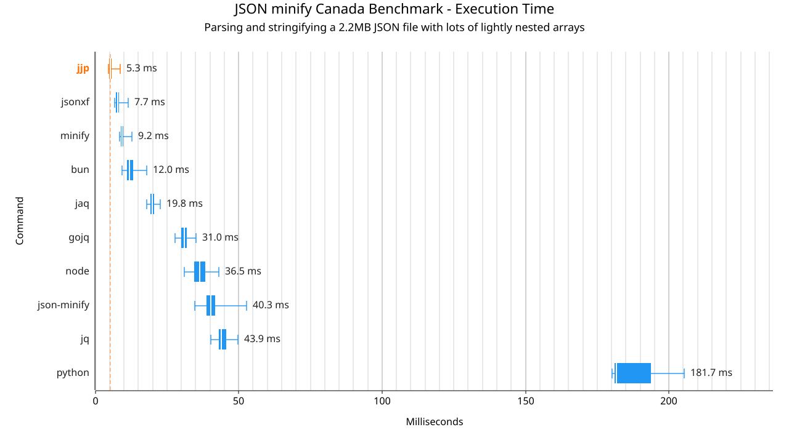

<!-- GENERATED FILE - update the templates in the xtask -->

# jjpwrgem CLI formatter and minifier benchmarks

Wall-clock timing against jq, prettier, dprint, and others via hyperfine. Run locally with `mise run bench-docker`
These benchmarks are run with `AMD Ryzen 5 5600X 6-Core Processor (3.70 GHz)`

The following JSON fixtures are used across benchmarks:

- [canada.json](/benches/data/canada.json) — 2.2MB, lots of lightly nested arrays, no strings

- [citm_catalog.json](/benches/data/citm_catalog.json) — 1.7MB, lots of lightly nested long objects, ASCII strings

- [twitter.json](/benches/data/twitter.json) — 0.6MB, lots of lightly nested short objects, multibyte strings

## canada

[canada.json](/benches/data/canada.json) — 2.2MB, lots of lightly nested arrays, no strings

### pretty canada

| Command        | Mean Wall Time [ms] |   Change | Factor         |
| :------------- | ------------------: | -------: | :------------- |
| `jjp`          |          11.0 ± 1.7 |          |                |
| `json-pp-rust` |          14.1 ± 1.4 |   +27.3% |                |
| `jsonice`      |          15.0 ± 0.9 |   +35.6% | (1.4x slower)  |
| `prettier`     |        716.4 ± 28.7 | +6387.5% | (64.9x slower) |
| `jq`           |          67.7 ± 6.3 |  +513.2% | (6.1x slower)  |
| `gojq`         |          32.5 ± 2.6 |  +193.9% | (2.9x slower)  |
| `jaq`          |          24.4 ± 1.1 |  +121.3% | (2.2x slower)  |
| `sjq`          |         194.6 ± 4.0 | +1662.2% | (17.6x slower) |
| `dprint`       |         281.3 ± 3.7 | +2447.9% | (25.5x slower) |
| `python`       |         201.1 ± 7.1 | +1721.4% | (18.2x slower) |
| `node`         |          47.8 ± 5.5 |  +332.6% | (4.3x slower)  |
| `bun`          |          16.4 ± 1.6 |   +48.1% | (1.5x slower)  |
| `jsonxf`       |           9.5 ± 3.2 |   -13.5% |                |
| `jsonformat`   |          15.6 ± 4.0 |   +41.2% | (1.4x slower)  |
| `oxfmt`        |         81.8 ± 21.5 |  +641.0% | (7.4x slower)  |

### ugly canada

| Command       | Mean Wall Time [ms] |   Change | Factor         |
| :------------ | ------------------: | -------: | :------------- |
| `jjp`         |           5.8 ± 0.8 |          |                |
| `json-minify` |          44.1 ± 7.8 |  +666.7% | (7.7x slower)  |
| `jsonxf`      |           9.9 ± 3.3 |   +71.4% | (1.7x slower)  |
| `jq`          |         63.6 ± 15.5 | +1005.7% | (11.1x slower) |
| `jaq`         |          21.5 ± 4.1 |  +273.4% | (3.7x slower)  |
| `gojq`        |         43.1 ± 16.6 |  +648.8% | (7.5x slower)  |
| `sjq`         |        201.4 ± 49.9 | +3398.8% | (35.0x slower) |
| `python`      |         199.8 ± 8.8 | +3370.9% | (34.7x slower) |
| `minify`      |           9.4 ± 0.6 |   +63.5% | (1.6x slower)  |
| `node`        |          37.3 ± 2.2 |  +548.4% | (6.5x slower)  |
| `bun`         |          12.3 ± 1.3 |  +113.1% | (2.1x slower)  |

## citm catalog

[citm_catalog.json](/benches/data/citm_catalog.json) — 1.7MB, lots of lightly nested long objects, ASCII strings

### pretty citm catalog

| Command        | Mean Wall Time [ms] |    Change | Factor          |
| :------------- | ------------------: | --------: | :-------------- |
| `jjp`          |           3.6 ± 0.7 |           |                 |
| `json-pp-rust` |           6.4 ± 1.7 |    +77.7% | (1.8x slower)   |
| `jsonice`      |           4.2 ± 0.7 |    +15.7% |                 |
| `prettier`     |         372.4 ± 8.5 | +10212.1% | (103.1x slower) |
| `jq`           |          22.5 ± 2.3 |   +523.3% | (6.2x slower)   |
| `gojq`         |          13.7 ± 0.5 |   +279.0% | (3.8x slower)   |
| `jaq`          |          10.2 ± 1.1 |   +182.5% | (2.8x slower)   |
| `sjq`          |          62.5 ± 3.6 |  +1631.3% | (17.3x slower)  |
| `dprint`       |         162.6 ± 1.8 |  +4403.2% | (45.0x slower)  |
| `python`       |         119.9 ± 7.6 |  +3219.5% | (33.2x slower)  |
| `node`         |          27.4 ± 3.6 |   +658.0% | (7.6x slower)   |
| `bun`          |           8.6 ± 1.1 |   +139.0% | (2.4x slower)   |
| `jsonxf`       |           1.9 ± 0.3 |    -46.9% | (1.9x faster)   |
| `jsonformat`   |           3.1 ± 0.5 |    -13.6% |                 |
| `oxfmt`        |          34.2 ± 3.6 |   +847.2% | (9.5x slower)   |

### ugly citm catalog

| Command       | Mean Wall Time [ms] |   Change | Factor         |
| :------------ | ------------------: | -------: | :------------- |
| `jjp`         |           2.1 ± 0.3 |          |                |
| `json-minify` |          23.2 ± 2.5 | +1025.4% | (11.3x slower) |
| `jsonxf`      |           1.9 ± 0.3 |    -8.2% |                |
| `jq`          |          17.2 ± 1.5 |  +735.3% | (8.4x slower)  |
| `jaq`         |           8.1 ± 0.8 |  +293.4% | (3.9x slower)  |
| `gojq`        |          13.3 ± 0.4 |  +543.4% | (6.4x slower)  |
| `sjq`         |          53.4 ± 1.8 | +2489.8% | (25.9x slower) |
| `python`      |         115.3 ± 9.4 | +5487.1% | (55.9x slower) |
| `minify`      |           4.1 ± 0.4 |   +99.0% | (2.0x slower)  |
| `node`        |          21.8 ± 1.8 |  +956.2% | (10.6x slower) |
| `bun`         |           7.0 ± 0.9 |  +238.1% | (3.4x slower)  |

## twitter

[twitter.json](/benches/data/twitter.json) — 0.6MB, lots of lightly nested short objects, multibyte strings

### pretty twitter

| Command        | Mean Wall Time [ms] |    Change | Factor          |
| :------------- | ------------------: | --------: | :-------------- |
| `jjp`          |           1.6 ± 0.3 |           |                 |
| `json-pp-rust` |           2.5 ± 0.6 |    +59.6% | (1.6x slower)   |
| `jsonice`      |           2.4 ± 0.4 |    +49.6% | (1.5x slower)   |
| `prettier`     |        204.6 ± 16.0 | +12723.8% | (128.2x slower) |
| `jq`           |          10.6 ± 1.0 |   +561.7% | (6.6x slower)   |
| `gojq`         |           8.0 ± 0.2 |   +403.4% | (5.0x slower)   |
| `jaq`          |           5.2 ± 0.7 |   +225.2% | (3.3x slower)   |
| `sjq`          |          27.3 ± 1.0 |  +1614.2% | (17.1x slower)  |
| `dprint`       |          29.6 ± 2.6 |  +1755.3% | (18.6x slower)  |
| `python`       |         102.7 ± 8.6 |  +6339.2% | (64.4x slower)  |
| `node`         |          23.1 ± 3.0 |  +1350.0% | (14.5x slower)  |
| `bun`          |           5.6 ± 0.9 |   +248.1% | (3.5x slower)   |
| `jsonxf`       |           0.8 ± 0.2 |    -47.6% | (1.9x faster)   |
| `jsonformat`   |           2.0 ± 0.3 |    +23.5% |                 |
| `oxfmt`        |          32.9 ± 3.9 |  +1964.5% | (20.6x slower)  |

### ugly twitter

| Command       | Mean Wall Time [ms] |   Change | Factor         |
| :------------ | ------------------: | -------: | :------------- |
| `jjp`         |           1.3 ± 0.3 |          |                |
| `json-minify` |          21.9 ± 2.2 | +1635.3% | (17.4x slower) |
| `jsonxf`      |           0.8 ± 0.2 |   -33.7% | (1.5x faster)  |
| `jq`          |           9.8 ± 1.2 |  +678.0% | (7.8x slower)  |
| `jaq`         |           4.8 ± 0.8 |  +281.4% | (3.8x slower)  |
| `gojq`        |           8.2 ± 0.6 |  +547.7% | (6.5x slower)  |
| `sjq`         |          25.0 ± 1.2 | +1884.3% | (19.8x slower) |
| `python`      |         101.6 ± 6.1 | +7952.4% | (80.5x slower) |
| `minify`      |           2.9 ± 0.3 |  +132.1% | (2.3x slower)  |
| `node`        |          20.2 ± 1.9 | +1497.1% | (16.0x slower) |
| `bun`         |           4.9 ± 0.8 |  +287.4% | (3.9x slower)  |
