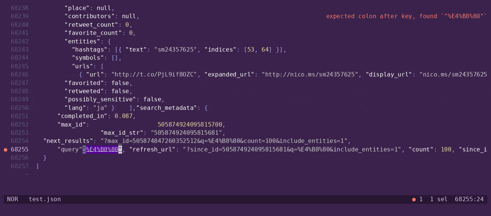

<!-- GENERATED FILE - update the templates in the xtask -->

LSP providing

- diagnostics
- code actions
- formatting
- document symbols
- folding ranges

Scales well for large files. There is no perceivable delay when editing a 68k line, 5MB file. Diagnostics, code actions, and formatting take around 20ms



## Installation

[Install `jjp`](../../readme.md#installation), then configure based on your editor

### VSCode

[VSCode extension](https://marketplace.visualstudio.com/items?itemName=20jasper.jjpwrgem-vscode)

### Generic LSP Client

For example, here's a Helix configuration

```toml
# languages.toml
[language-server.jjp]
command = "jjp"
args = ["lsp"]

[language-server.jjp.config.format]
# Pretty print, or remove all insignificant whitespace (uglify, also known as minify)
#   "pretty": Pretty print with indentation and line breaks
#   "uglify": Remove all insignificant whitespace
# mode = "pretty"

# Preferred maximum line width. Note this is not a hard maximum width
# Ignored when mode is "uglify"
# preferredWidth = 80

# Line ending to use when formatting output
#   "lf": Unix line endings (LF)
#   "crlf": Windows line endings (CRLF)
# endOfLine = "lf"

[[language]]
name = "json"
language-servers = ["jjp"]
```
