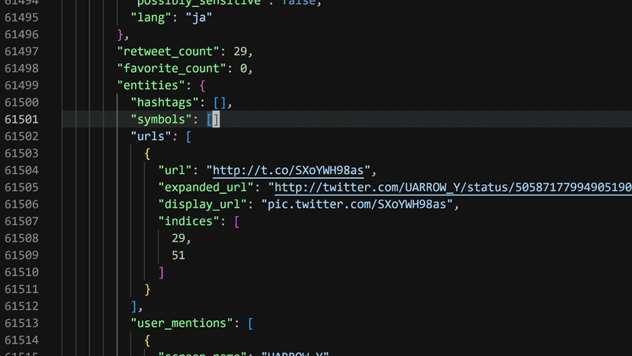

<!-- GENERATED FILE - update the templates in the xtask -->

# JJPWRGEM

JSON language server with rich error messages



[On large JSON files, diagnostics are up to ~5x faster and use ~20–25x less RAM than VSCode's LSP](https://github.com/20jasper/JJPWRGEM/blob/main/benches/lsp/lsp.md)

## Requirements

Install `jjp`

**mise**

```bash
mise use -g github:20jasper/jjpwrgem
```

**Cargo**

```bash
cargo install jjpwrgem --locked
```

**npm**

Not recommended on Windows because of its overhead: on macOS and Linux npm runs the native binary directly, but on Windows every call goes through Node.

npm 11 and newer:

```bash
npm install -g jjpwrgem --allow-scripts=jjpwrgem
```

npm 10 and older:

```bash
npm install -g jjpwrgem
```

Or download a binary from [releases](https://github.com/20jasper/JJPWRGEM/releases).

## Features

LSP providing

- diagnostics
- code actions
- formatting
- document symbols
- folding ranges

Scales well for large files. There is no perceivable delay when editing a 68k line, 5MB file. Diagnostics, code actions, and formatting take around 20ms

## Settings

### `jjpwrgem.format.mode`

Output style

- `"pretty"` (default): Pretty print with indentation and line breaks
- `"uglify"`: Remove all insignificant whitespace, also known as minifying

### `jjpwrgem.format.preferredWidth`

Preferred maximum line width. Note this is not a hard maximum width

Default `80`.

Ignored when `jjpwrgem.format.mode` is `"uglify"`.

### `jjpwrgem.format.endOfLine`

Line ending to use when formatting output

- `"lf"` (default): Unix line endings (LF)
- `"crlf"`: Windows line endings (CRLF)
