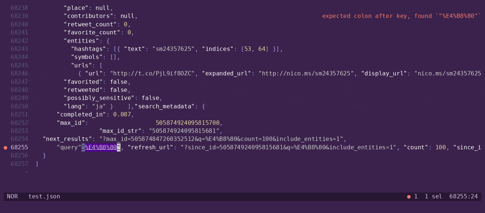

<!-- GENERATED FILE - update the templates in the xtask -->

# JJPWRGEM

JJPWRGEM JSON Parser With Really Good Error Messages

An RFC 8259 compliant JSON language server and formatter!

```
$ echo -en "{\"coolKey\"}" | jjp check
error: expected colon after key, found `}`
 --> stdin:1:11
  |
1 | {"coolKey"}
  |  ---------^
  |  |
  |  expected due to `"coolKey"`
  |
help: insert colon and placeholder value
  |
1 | {"coolKey": "🐟🛹"}
  |           ++++++++

```

 [](https://codspeed.io/20jasper/JJPWRGEM?utm_source=badge)

## Why JJP?

- Rich errors with context, descriptions, and patches
- [On large JSON files, diagnostics are up to ~5x faster and use ~20–25x less RAM than VSCode's LSP](https://github.com/20jasper/JJPWRGEM/blob/main/benches/lsp/lsp.md)
- Parses and pretty prints a 1.7MB file in ~7ms — [benchmarks](https://github.com/20jasper/JJPWRGEM/blob/main/benches/BENCHMARKS.md)



Also there's a really cool axolotl riding a skateboard as the logo


## Installation

### Precompiled

```bash
mise use -g github:20jasper/jjpwrgem
```

Or `npm install -g jjpwrgem`, `cargo install jjpwrgem --locked`, or download a binary from [releases](https://github.com/20jasper/JJPWRGEM/releases)

### From source

```bash
RUSTFLAGS="-C target-cpu=native" cargo install --path .
```

### LSP

See [LSP setup](https://github.com/20jasper/JJPWRGEM/blob/main/crates/lsp/readme.md#quick-start) to configure your editor, and [settings](https://github.com/20jasper/JJPWRGEM/blob/main/crates/lsp/readme.md#settings) for the format options

## JSON output

`jjp check` and `jjp format` print a single line of json with `--reporter json`, or `--json` for short. Successes go to stdout and failures go to stderr. Exit codes are the same as the default pretty output.

Check success

```bash
$ echo '{"a": 1}' | jjp check --json
{"success":true}
```

Format success

```bash
$ echo '{"a":[1,2]}' | jjp format --json
{"success":true,"output":"{ \"a\": [1, 2] }"}
```

Syntax error. See [`schemas/reporter.schema.json`](schemas/reporter.schema.json) for the JSON Schema, which documents every field

```bash
$ echo '{"coolKey"}' | jjp check --json
{"success":false,"error":{"kind":"diagnostic","message":"expected colon after key, found `}`","file":"stdin","range":{"start":{"byteFromStart":10,"line":1,"charColumn":11},"end":{"byteFromStart":11,"line":1,"charColumn":12}},"context":[{"message":"expected due to `\"coolKey\"`","range":{"start":{"byteFromStart":1,"line":1,"charColumn":2},"end":{"byteFromStart":10,"line":1,"charColumn":11}}}],"fixes":[{"message":"insert colon and placeholder value","range":{"start":{"byteFromStart":10,"line":1,"charColumn":11},"end":{"byteFromStart":10,"line":1,"charColumn":11}},"replacement":": \"🐟🛹\""}]}}
```

Other errors, like missing stdin

```bash
$ jjp check --json
{"success":false,"error":{"kind":"message","message":"expected non empty input from stdin","help":"pipe data to stdin like so\n$ echo -en \"{\\\"hello I am valid\\\": null} \" | jjp check\n"}}
```

## Stability

Internal libraries are likely unstable. Formatting output is unstable

## FAQ

### What does JJPWRGEM stand for?

JJPWRGEM JSON Parser With Really Good Error Messages. I was inspired by GNU to make a recursive acronym

### How do you pronounce JJPWRGEM?

/ˈdʒeɪ dʒeɪ ˈpaʊər dʒɛm/ JAY-jay-POW-er-jem

### But why is it called that?

It sounds cool and the name isn't taken on any package managers

### Is it blazingly fast™?

Axolotls can't walk so fast, so skateboards are pretty fast 🛹🐟

See the [benchmarks](https://github.com/20jasper/JJPWRGEM/blob/main/benches/BENCHMARKS.md)

### Why is the logo an axolotl riding a skateboard?

It's cool

### How long is an axolotl?

According to the San Diego zoo, "[a]n axolotl can reach 12 inches in length, but on average grows to about 9 inches[^axolotlFact]"

[^axolotlFact]: https://animals.sandiegozoo.org/animals/axolotl
