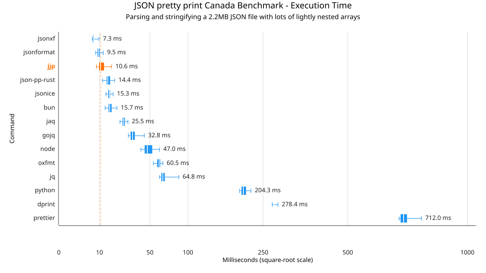
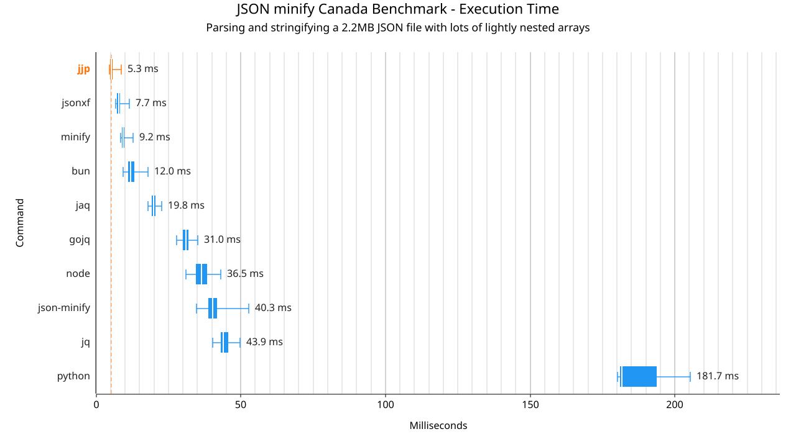
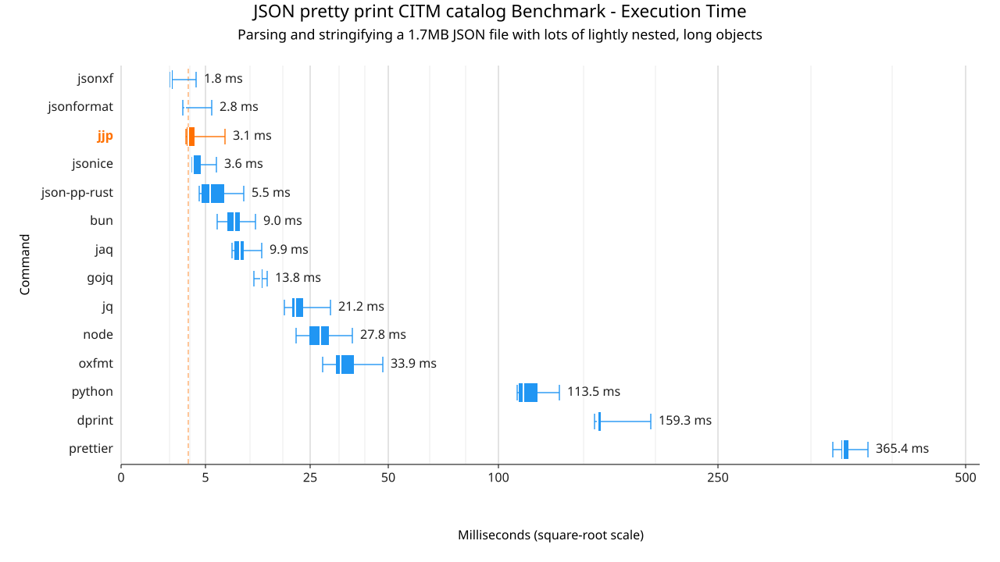
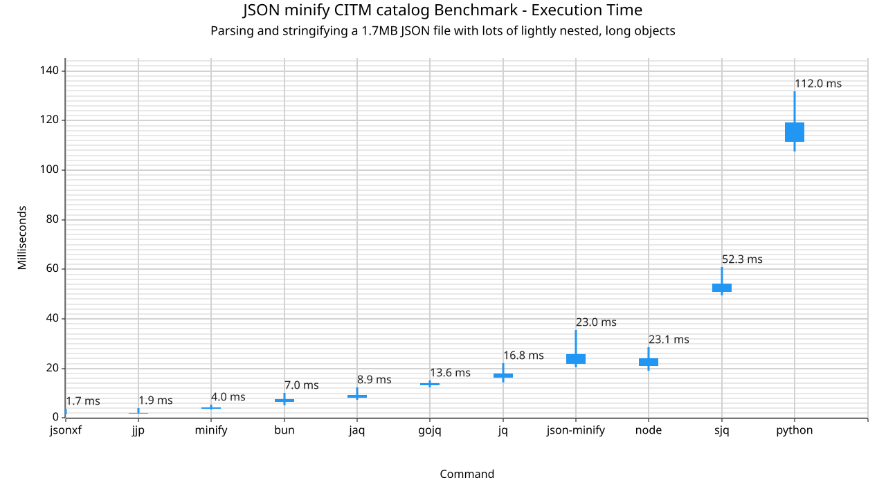
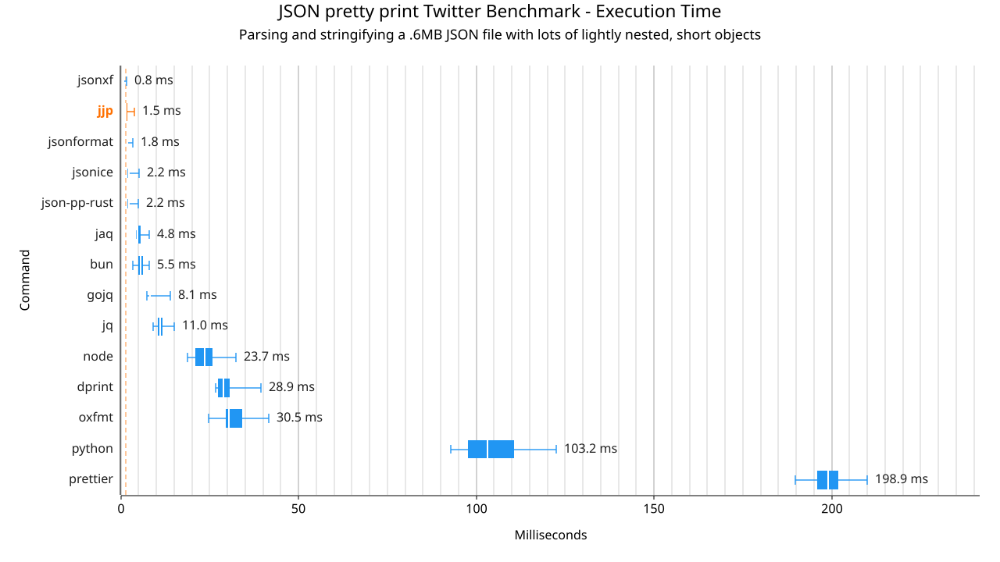
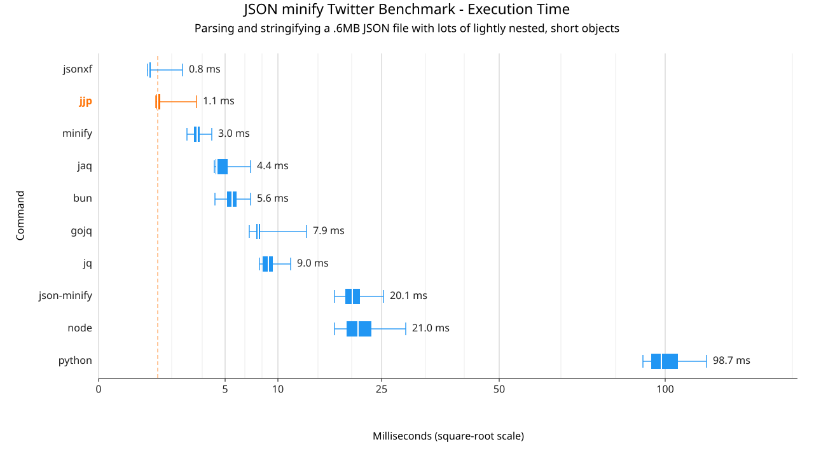

# jjpwrgem CLI formatter and minifier benchmarks

Wall-clock timing against jq, prettier, dprint, and others via hyperfine. Run locally with `mise run bench-docker`




## canada



### pretty canada



### ugly canada



## citm catalog



### pretty citm catalog



### ugly citm catalog



## twitter



### pretty twitter



### ugly twitter


