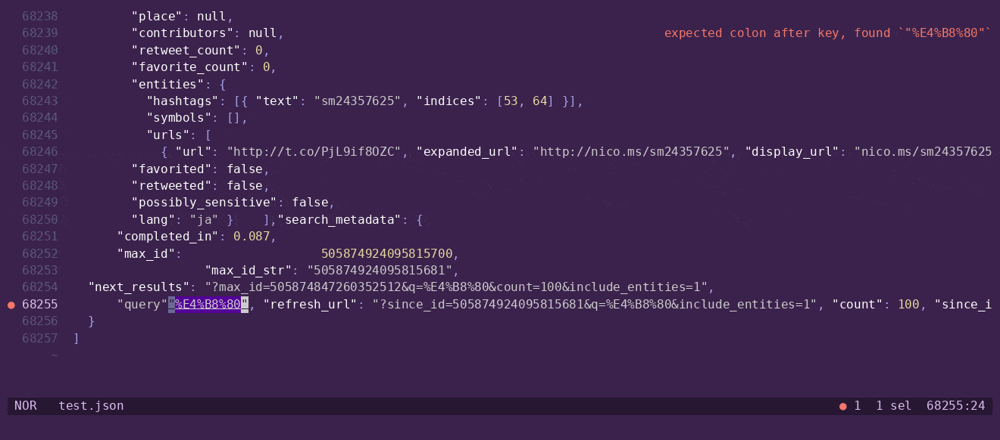





## Installation

[Install `jjp`](https://github.com/20jasper/JJPWRGEM/blob/main/readme.md#installation), then configure based on your editor

### VSCode

[VSCode extension](https://marketplace.visualstudio.com/items?itemName=20jasper.jjpwrgem-vscode)

### Generic LSP Client

Run `jjp lsp` as the language server for JSON files. See the [Helix](#helix) section for a full example configuration.

{{ lsp_settings_reference }}

### Helix

```toml
# languages.toml
[language-server.jjp]
command = "jjp"
args = ["lsp"]

{{ helix_format_config }}

[[language]]
name = "json"
language-servers = ["jjp"]
```
